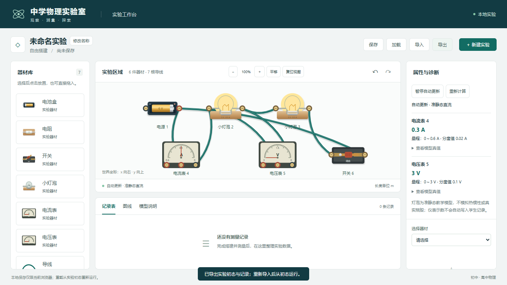
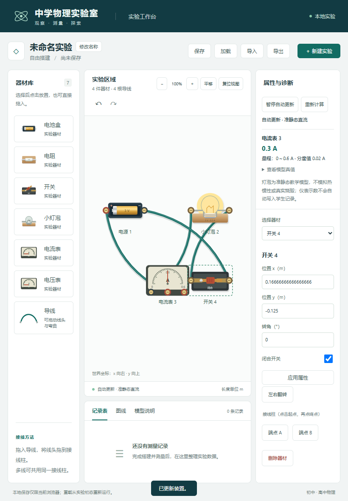

# 闭合开关自动更新修订

日期：2026-11-04。用户要求闭合开关直接显示灯泡和电表效果，不再先点“开始计算”。

默认自动运行：放置器材、接线、开合开关及应用参数后自动求解，打开/加载/导入/刷新实验后按初态自动重新计算。空白且无器材不启动 Worker。操作区改为“暂停自动更新 / 恢复自动更新”和“重新计算”；主动暂停后修改装置会清除失效读数，重新计算会建立新运行并恢复更新。原 20 ms 合并请求、过期任务终止、10 s 超时和文档/revision/runId/sequence 校验保持，物理公式、持久化格式和学生记录不变。

实际检查：

- build（包含三份 TS 配置）和 lint 退出码 0；[构建输出](m2-auto-update-build.txt)、[lint](m2-auto-update-lint.txt)、[产物 SHA256](m2-auto-update-build-manifest.json)。
- 完整 Edge 28/28 通过，50.2 秒，0 失败/跳过/重试；[原始 JSON](m2-auto-update-e2e.json)、[输出](m2-auto-update-e2e.txt)。
- 增强原有 4 项电学用例：空白真实搭建无启动按钮、鼠标刀柄与属性复选框闭合后 0.3 A / 3 V、断开回到 0 A / 灭灯；翻转/保存/刷新后自动复算且导出初态一致；导入后自动选档/反偏/超量程/误接诊断，暂停编辑清除旧值，恢复及重新计算正确；延迟旧 Worker 无法覆盖新运行且活动 Worker 峰值 1、结束 0；原生软件触摸直接闭合亮灯并偏转表针。
- 81 个起始源码/测试/脚本中 77 个哈希保持，仅 App.tsx、useElectricalSimulation.ts、SimulationPanel.tsx、electrical.spec.ts 改动。物理核心未改，本次未重复运行前次 172 项单元/模型；全部既有浏览器用例保留，无新增依赖或现有注释修改。[起始哈希](m2-auto-update-before.json)与[最终核对](m2-auto-update-integrity.json)留存。

桌面与触摸截图已目视检查：

软件触摸不冒充实体平板验收。沿用原准静态教学模型与异常诊断，不模拟热惯性/烧毁；任务 07 的测量记录/CSV 未实施。本次测试使用独立浏览器上下文，预览服务结束后回收，未操作用户真实保存数据或部署。
