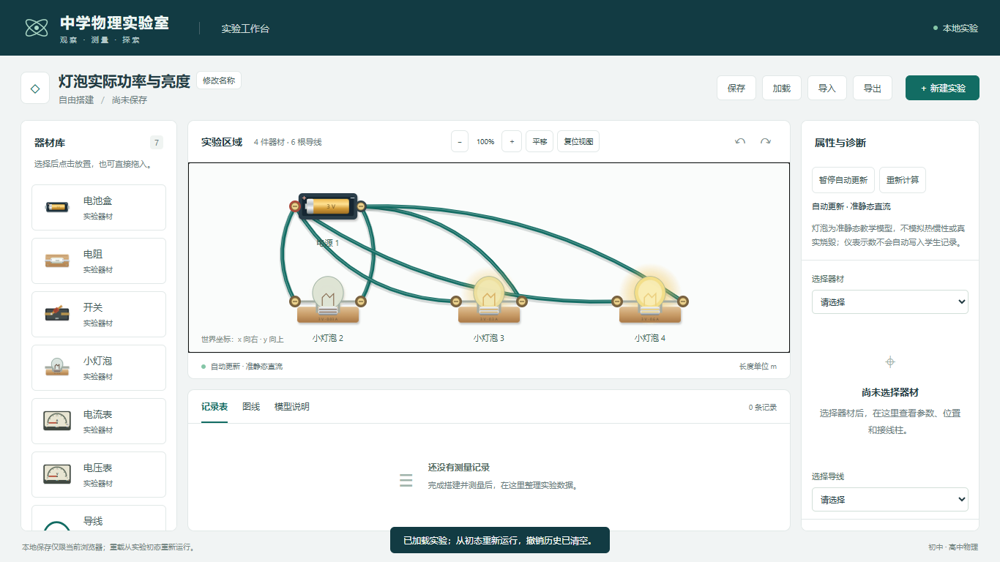

# 灯泡功率与连续亮度修订

日期：2026-11-04。用户反馈改变电路后灯泡看起来一样亮。

定位到两处显示原因：原玻璃和灯丝仅按 brightness 是否非零选择同一颜色；原 `clamp(P/(Ur·Ir),0,1)` 在额定点封顶，并将不同额定功率灯泡的额定工作点都画成一样亮。原电路方程仍按真实功率求解，没有把灯泡替换为定值电阻。

修订为统一参考 0.9 W 的教学显示映射 `b=max(P,0)/(max(P,0)+0.9 W)`，所有灯泡共用标尺；玻璃发光层、高光、灯丝颜色/粗细以及光晕透明度/尺寸连续变化，不在额定功率处封顶。悬停灯泡显示耗散功率。该映射不是实测光通量或型号光效模型，0.9 W 是显示参考，不代表烧毁阈值。电路的 U/I/P、本构、残差、模型范围、自动更新与保存格式保持。

独立基准：

| 默认灯泡电压 | 电流 | 实际功率 | 显示强度 b |
| --- | --- | --- | --- |
| 0.6 V | 0.15 A | 0.09 W | 1/11 |
| 3 V | 0.3 A | 0.9 W | 1/2 |
| 9 V | 0.45 A | 4.05 W | 9/11 |

不同灯泡串联（源 28/9 V）仍为共同电流 0.2 A、分压 10/9 V 和 2 V，功率 2/9 W 和 0.4 W，对应 b=20/101 和 4/13，证明仅凭相同电流不能判定不同灯泡等亮。3 V 并联的 0.3 A / 0.2 A 额定灯泡分别 0.9 W / 0.6 W，b=0.5 / 0.4；相同参数、相同工作点仍应等亮。

实际验证：

- 全量 173/173 单元/模型通过，0 失败/跳过/取消，约 0.98 秒；新增一项多工作点基准，增强不同灯泡及历史额定点断言。[原始输出](m2-lamp-brightness-tests.txt)。
- 完整 Edge 29/29 通过，39.6 秒，0 失败/跳过/重试；新增一项实际浏览器对比，验证 0.09/0.9/1.8 W 的 SVG 发光层透明度、不同灯丝颜色和逐渐扩大的光晕；同一灯泡从 0.9→4.05 W 继续变亮，零输入时全部熄灭。原开关、自动更新、触摸、双表、旧回包与保存回归保留。[JSON](m2-lamp-brightness-e2e.json)、[输出](m2-lamp-brightness-e2e.txt)。
- 三份 TS 类型检查、lint、build 退出码 0；[构建](m2-lamp-brightness-build.txt)、[lint](m2-lamp-brightness-lint.txt)、[产物哈希](m2-lamp-brightness-build-manifest.json)。
- 81 个基线源码/测试/脚本中 76 个 SHA256 不变，仅 lamp.ts、solve.ts 的亮度映射调用、EquipmentGraphic.tsx 及两份相关测试变化；无新包、锁文件或已有注释修改。[起始哈希](m2-lamp-brightness-before.json)、[最终检查](m2-lamp-brightness-integrity.json)。

下图从左到右实际功率为 0.09 W、0.9 W、1.8 W；截图已目视检查：

[软件触摸截图](m2-lamp-brightness-touch.png)也已更新，软件触摸不冒充实体平板验收。未加入热惯性/烧毁或学生采样；下一任务仍为 07。测试使用独立上下文，预览服务已结束，未修改用户真实浏览器数据或部署。
