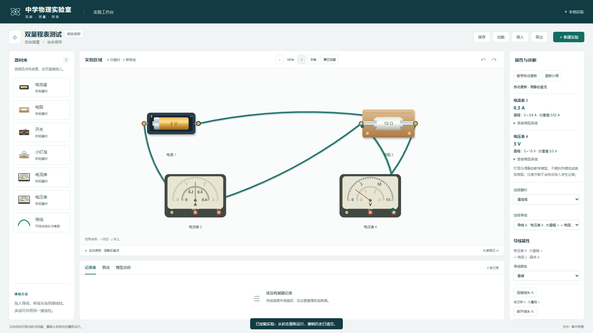

# 双圈电表刻度与线头标记

日期：2026-11-04。用户反馈两档电表仅显示一圈刻度，且电压表“15”旁有小 B。

原实现只按当前量程重画一圈；小 B 实际是选中导线的 B 端浮动标记，叠在已连接的电表接线柱上方，并非仪表符号。

现同时绘制两圈固定标尺，外圈大量程、内圈小量程：

| 器材 | 外圈 | 内圈 |
| --- | --- | --- |
| 电流表 | 0～3 A，0/1/2/3 | 0～0.6 A，0/0.2/0.4/0.6 |
| 电压表 | 0～15 V，0/5/10/15 | 0～3 V，0/1/2/3 |

各圈独立使用该档上限/分度值，接线使用的档加粗高亮，另一圈保持可读；切档不替换标尺，按所接量程调整同一指针。自定义量程、分度值和翻转沿用原参数/几何约定。

已连接线头不再绘制浮动 A/B，悬停与属性区仍可识别/操作对应线头。选中的自由线头显示带底色的“线头 A/B”，避免误认为表盘数字或符号。

实际检查：

- 三份 TS 配置类型检查、lint、build 均退出码 0；[构建输出](m2-meter-scales-build.txt)、[lint](m2-meter-scales-lint.txt)、[产物 SHA256](m2-meter-scales-build-manifest.json)。
- 完整 Edge 32/32 通过，46.0 秒，0 失败/跳过/重试；[JSON](m2-meter-scales-e2e.json)、[原始输出](m2-meter-scales-e2e.txt)。新增 1 项电表用例，保留原 31 项。
- 新用例验证两表的全部默认数字、两圈各 30 分格、按实际接线高亮；0.3 A 在小/大量程下分别对应半程/十分之一程；改小档分度值为 0.05 A 后内圈 12 格、外圈仍 30 格；翻转不改变读数；已接端无浮动标签、拔开后有明确自由线头标签。
- 83 个起始源码/测试/脚本中 80 个 SHA256 不变，仅 MeterGraphic.tsx、SceneBoard.tsx 和既有 electrical.spec.ts 改动。[起始哈希](m2-meter-scales-before.json)、[最终核对](m2-meter-scales-integrity.json)。物理核心未改，本次未重复运行上一轮 177 项单元/模型；无新依赖、锁文件或现有注释修改。

195% 视图下，已选中电压表相连导线，双圈可见且无字母遮挡，截图已目视核对：

测试使用独立上下文，预览服务已退出，无用户真实保存数据操作或发布；下一任务仍为 07。
