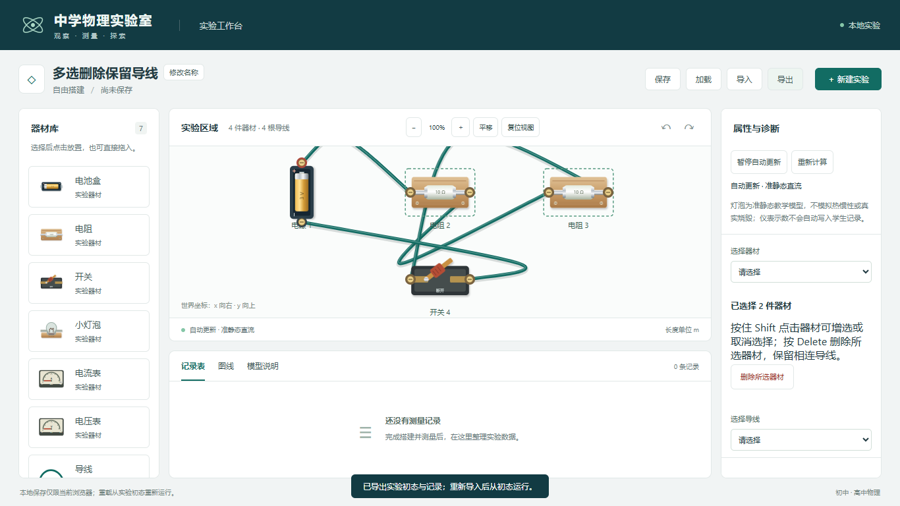
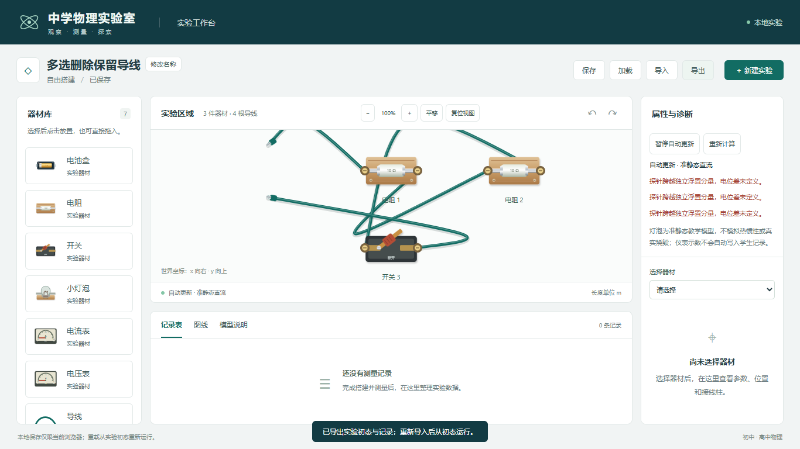

# Shift 多选、Delete 与保留导线

日期：2026-11-04。按用户要求修改工作台选择和器材删除行为，覆盖早期删除时连线一并移除的约定。

## 交互与数据

- 点击器材单选；按住 Shift 点击增选/取消选中，Shift+Enter/Space 支持键盘选择。多选显示全部边框及属性区数量，Shift 点击开关刀柄仅选择，不改变开关状态。
- 按 Delete 删除单件或整组，属性区单件/多件删除按钮走同一命令；选中导线时 Delete 删除该线。输入框、选择框、可编辑文本和文档模态流程不会误触发器材删除。
- 器材删除前按原姿态（包括旋转、翻转）计算端口世界坐标，再把相应线头转为自由线头。导线 ID、弯曲点、其他器材上的端子均保持；两端器材都删除时保留完整自由线。
- 多件删除只提交一个命令、一个 revision 和一笔历史，撤销/重做整体恢复或删除。删除后焦点回到画布，可继续用 Ctrl+Z。未知 ID 或已有测量记录引用的器材仍整批拒绝，不产生部分删除。
- 选择仅为会话 UI 状态，多选用于批量删除，拖动仍按单件处理。文档格式仍为 2，复用既有自由线头字段；保存/导出可完整恢复。

## 实际验证

| 检查 | 结果 |
| --- | --- |
| 单元/模型 | 177/177，0 失败/跳过/取消，约 1.07 秒；[输出](m2-selection-delete-tests.txt) |
| 完整 Edge 回归 | 31/31，45.5 秒，0 失败/跳过/重试；[JSON](m2-selection-delete-e2e.json)、[输出](m2-selection-delete-e2e.txt) |
| 类型与构建 | 三份 TS 配置及 build 退出码 0；[输出](m2-selection-delete-build.txt)、[产物哈希](m2-selection-delete-build-manifest.json) |
| lint | 无警告、退出码 0；[输出](m2-selection-delete-lint.txt) |

新增 4 项核心用例验证选择增减/替换、旋转翻转端口位置和全部弯曲点保持、双端共享线批量删除、一次撤销/重做及失败原子性。新增 2 项浏览器用例验证输入框 Delete、单件/整组删除、Shift 开关和键盘、导线 Delete、焦点、端点屏幕位置不跳变、初态导出一致及保存刷新恢复。旧工作台、历史、assembly 和 persistence 测试保留，仅将旧级联删除断言调整为用户要求的保线行为。

81 个起始源码/测试/脚本中 70 个 SHA256 不变，11 个为预期集成/删除/旧断言调整，新增两份测试；原物理求解、亮度、Worker、多实验存储未改。无新依赖或现有注释修改，包配置/唯一锁文件、原方案及 AGENTS.md 保持。[起始哈希](m2-selection-delete-before.json)、[最终检查](m2-selection-delete-integrity.json)留存。

截图已目视核对多选边框、数量及删除后的自由线头：

测试仅操作独立浏览器上下文，预览服务已回收，无用户真实保存数据修改或部署。本次不进入任务 07。
