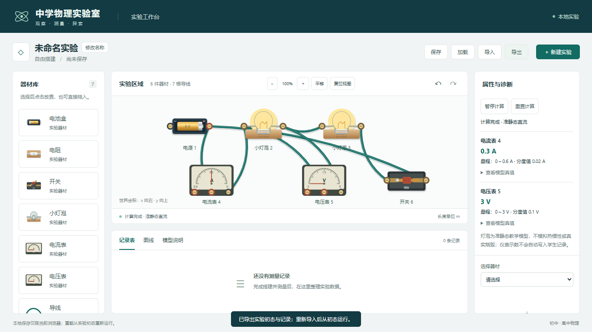
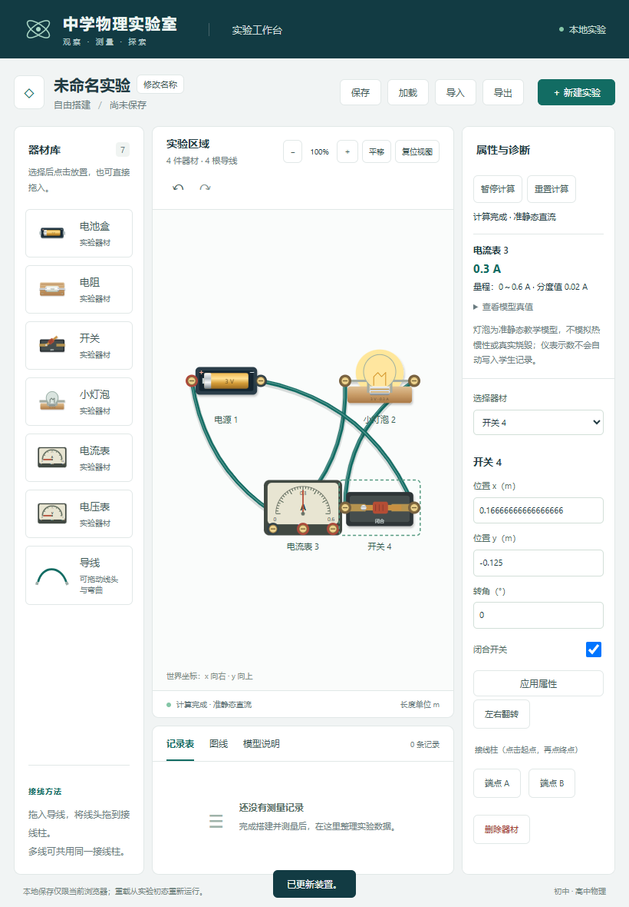

# M2 / 任务 06 实际验收

日期：2026-11-04。任务 06 工程门槛通过，包含用户追加的左右翻转、直接开合开关及通电反应。正式课堂与任务 08 实验闭环未验收。

## 实现与操作

器材库新增实物灯泡、电流表和电压表；选择器材后“左右翻转”，接线柱和已接导线同步跟随，电池电压与刻度文字正向可读。翻转、参数修改及开关动作均可撤销/重做、保存/加载。

用真实端口搭建电源—灯泡—电流表—开关回路，电压表并联到目标灯泡；电表使用公共端及一个量程正端。点击“开始计算”，再点击/触摸开关刀柄开合；闭合时灯泡按功率发光、电表指针及侧栏值同步更新，断开时恢复真实零电流。支持暂停/重置，错误或旧版本结果不能留下正常读数。

公式、阻尼、上限、残差、仪表分辨率及 Worker 协议见[模型说明](../models/lamps-and-meters.md)，实现决策见[0008](../decisions/0008-m2-lamps-meters-and-scheduling.md)。

## 实际检查

| 检查 | 结果与证据 |
| --- | --- |
| 全量单元/模型 | 172/172，0 失败/跳过/取消，约 1.20 s；[TAP](m2-task06-tests.tap) |
| 完整 Edge 浏览器 | 28/28，0 失败/跳过/重试，37.8 s；[JSON](m2-task06-e2e.json)、[输出](m2-task06-e2e.txt) |
| 类型与生产构建 | 三份 TS 配置通过；独立 Worker 成功打包；[输出](m2-task06-build.txt)、[SHA256 清单](m2-task06-build-manifest.json) |
| lint | 退出码 0，无警告；[输出](m2-task06-lint.txt) |
| 开发启动 | 独立端口 5175 HTTP 200，检查后关闭本任务服务；[输出](m2-task06-dev.txt) |
| 直接模型演示 | series/parallel/different 正常，NON_CONVERGENCE/METER_MULTI_RANGE 无正常 solution；[JSON](m2-task06-demo.json) |

保留原 150 项单元/模型与 24 项浏览器回归；新增 14 项灯泡/仪表、5 项协议、3 项翻转核心用例及 4 项浏览器用例。覆盖不同灯泡串/并联、混合阻抗、反向/零输入、a=0、非有限参数、模型范围、强制迭代失败、浮置电压、反偏/超量程/双正端、舍入、有限电表阻抗；翻转的先后次序、端口/导线跟随、历史、JSON 与旧文档兼容也均验证。

浏览器从空白真实放置/接线运行两灯泡、双表和开关，验证直接开合、指针/亮度、翻转后值不变及保存重载。错误修改后清除旧值，撤销后重算。另以延迟的真实 Worker 回包复现 reset→编辑→新运行，确认旧包无法覆盖，活动 Worker 峰值为 1、结束为 0。软件原生触摸覆盖放置/接线/开合及指针反应。

首轮新增浏览器测试有两处测试定位问题：放置第二只灯泡后 `.last()` 改指对象，以及改接线头后属性区选中了导线。分别固定器材 ID、明确重选电表，保留全部断言；[首轮失败输出](m2-task06-first-e2e.txt)留存。

截图目视检查还发现触摸后 SVG 的浏览器原生焦点轮廓被坐标缩放放大成黑块；已关闭该原生轮廓，改用专用可见焦点边框，并加入 outline 回归检查。最终触摸截图在移除焦点之前取得，完整回归再次通过。

## 独立基准与截图

- 两默认灯泡 6 V 串联：模型 I=0.30000000000000787 A，每灯 3 V，显示 0.3 A / 3 V，两灯亮度 1。
- 两默认灯泡 3 V 并联：总 I=0.6000000000000159 A，各 3 V，显示 0.6 A / 3 V。
- 不同灯泡串联：源 28/9 V、第二只 2 V/0.2 A，预期共同 I=0.2 A，U1=10/9 V、U2=2 V；测试和演示独立验证，不以串联等压作假设。
- 6 V 源配 1 Ω 电流表、10 Ω 负载和 10 Ω 有限电压表：预期总电流 1 A、电压 5 V，证明有限阻抗参与真实网络。

[390 px 窄屏截图](m2-task06-narrow.png)验证主操作可达、无横向溢出。软件触摸不冒充实体平板验收。

## 保持与范围

无新增依赖，package.json / package-lock.json 保持；原物理小样及其测试、原方案、AGENTS.md 与已有注释保持。70 个起始基线中 55 个 SHA256 不变，15 个为预期实现/集成及旧注册表断言调整；[起始哈希](m2-task06-before.json)与[最终检查](m2-task06-integrity.json)保留。192 个文本文件严格 UTF-8 检查通过，251 个相对文档链接有效，5 个构建产物哈希与第三方声明一致。原生 Worker 与新增图形均由本项目编写，第三方声明继续随构建保留。

全局 apparatus 模式仍需配置；电表自身有限阻抗已支持。未施加随机误差，不模拟热惯性/烧毁，不自动采样学生记录。下一任务为 07：测量、记录表、图线与导出；正式实验步骤/模板仍属任务 08。本次未创建 Git/CodeGraph、未部署或操作用户真实浏览器保存数据。
