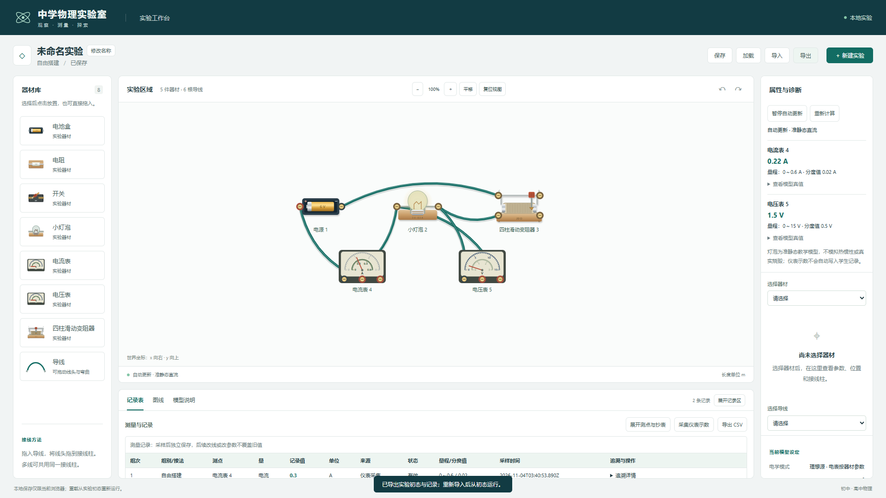

# M3 用户追加：四柱滑动变阻器实际验收

日期：2026-11-04。器材库与实验区的四柱变阻器、接线及鼠标/触摸滑片已完成；正式任务 08 未实施。

## 交付与操作

拖入“四柱滑动变阻器”，下柱 A/B 接电阻丝两端，上柱 C/D 共用滑片。默认最大电阻 20 Ω、滑片在中点；属性区可修改。接一上一下可调，A-B 固定全阻，C-D 直接导通，三柱/四柱接线按完整网络求解。

红色滑片支持鼠标/触摸拖动及旋转翻转后的坐标变换，方向键微调 0.01，Shift+方向键 0.1，Home/End 到端点；默认自动计算时灯泡和电表随位置响应。松手一次历史提交，Escape/触摸取消回滚，支持撤销/重做与保存刷新。预览不改文档、保存标记或旧测量快照，预览期间不能采集，松手完成计算后再采样。

详见[模型与独立基准](../models/rheostat.md)及[范围决策](../decisions/0010-m3-four-post-rheostat.md)。器材为原创实物 SVG，无新增包或外部素材。

## 实际检查

| 检查 | 结果与证据 |
| --- | --- |
| 全量单元/模型 | 203/203，失败/跳过/取消均为 0，约 1.23 秒；[原始输出](m3-rheostat-tests.txt) |
| 完整 Edge E2E | 41/41，失败/跳过/重试均为 0，78.0 秒；[原始输出](m3-rheostat-e2e.txt)、[JSON](m3-rheostat-e2e.json) |
| 三份 TS 配置与生产构建 | 退出码 0；[输出](m3-rheostat-build.txt)、[SHA256 清单](m3-rheostat-build-manifest.json) |
| lint | 退出码 0、无警告；[输出](m3-rheostat-lint.txt) |
| 独立模型演示 | 6 V/10 Ω/20 Ω 的四类接法及带负载分压；[实际 JSON](m3-rheostat-demo.json) |
| 开发启动 | 独立 5175 端口 HTTP 200、HTML 含开发入口，检查后停止本任务进程；[输出](m3-rheostat-dev.txt) |

原有 193 项单元/模型、37 项浏览器用例保留，新增 10/4 项。原自由导线测试补充滚动到卡片后再拖动，以适应器材库新增一行；没有删断言或改变原行为预期。

核心覆盖四柱注册/非法值/下溢、两种上柱及两种下柱的调节方向、A-B 恒阻/C-D 导通、端点真实零阻及理想源短路、带负载分压、多器材/最长 ID/恶意前缀碰撞及排序稳定、旋转翻转/抓取偏移/边界、事务历史/JSON、旧采样参数保持与 1800 端子边界。独立手算为 A-C 的 t=0/0.5/1 对应 0.6/0.3/0.2 A；带负载分压为 36/11 V 和 18/55 A，实际残差满足原求解器门槛。

浏览器验证从空白拖入实物、实际接线、灯泡连续亮度/表针随滑片变化；拖动中 revision/存档/旧记录不变、采集禁用，松手仅增加一版；取消、撤销/重做、Home/End、保存刷新恢复。另覆盖三类接法、非法参数拒绝、最低缩放四柱独立接线、翻转、Delete 保线/撤销，以及 820×1180 软件触摸的旋转+翻转滑片和 pointercancel 回滚。原电学/测量/存储/导线/布局回归全部通过。

## 修复过程与截图

首轮 38 通过、3 失败：[输出](m3-rheostat-e2e-first-run.txt)、[JSON](m3-rheostat-e2e-first-run.json)。滑片预览原来仅按 80 ms 前沿限速，停止移动后可能漏掉末位置，现补发最后位置并在取消时清除计时器；最低缩放时已接线端点点击范围遮住相邻下柱，现按四柱间距缩小；原自由导线测试原地取坐标拖动已滚出视口的卡片，补充真实滚动。修正后重新 build 并通过全量 41 项。

三张最终截图已目视检查：

[四柱接线与左右翻转](m3-rheostat-four-posts.png)、[旋转翻转后的软件触摸](m3-rheostat-touch-rotated.png)。软件触摸不等同于实体触屏验收。

## 保持与限制

93 个起始源码/测试/脚本中 81 个 SHA256 不变，12 个为器材注册/适配器/端子上限/UI/预览调度及两份既有测试的预期改动；新增 6 个源码/测试/演示文件。[起始基线](m3-rheostat-before.json)、[最终核对](m3-rheostat-integrity.json)保留。MNA/非线性/灯泡/仪表求解实现、测量记录/CSV、Worker 协议与存储模块保持，既有注释未修改；原方案、AGENTS.md、唯一锁文件和依赖清单核对，无 Git/CodeGraph 初始化。

模型为理想电阻丝与滑片，不模拟温升、接触电阻、额定电流、烧毁、AC/RLC 或热惯性。分量最多 256 未知量、病态拒绝及测量过期保护继续生效。实体触屏/笔、其他浏览器、设备性能及课堂/发布验收仍待进行。
