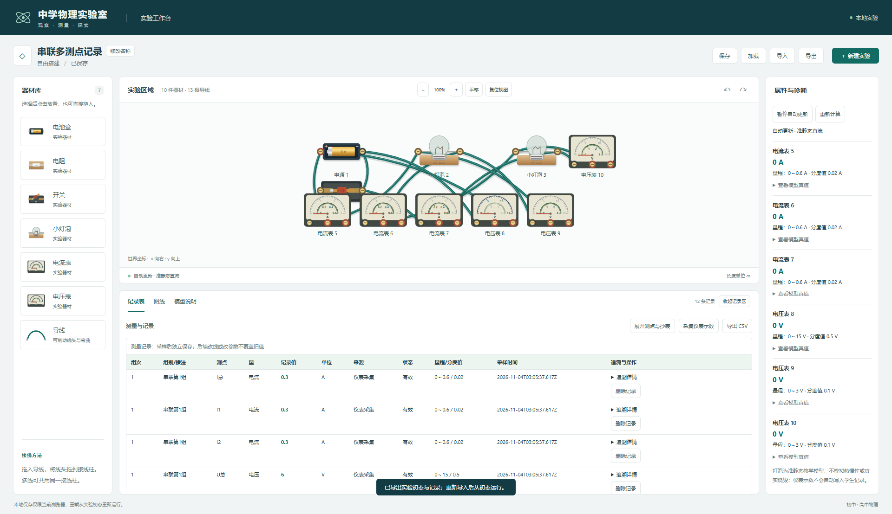
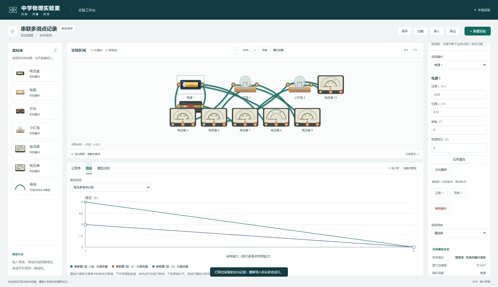

# M3 / 任务 07 实际验收

日期：2026-11-04。测量、记录表、图线与导出工程门槛通过；任务 08 的模板/问题/分层提示与正式实验闭环未实施，课堂及发布验收未进行。

## 交付行为

记录表支持同时选择多个电表，填写组别/接法、测点名称和备注，点击采集当前档位的仪器显示值，或由学生手工输入估读值。两种来源分开保存，手工输入不预填/不被真值覆盖；留空保存缺失状态，异常只保留状态和原文。手工行可修订、记录可删除，操作进入撤销/重做。

每次采样共用一份接线/器材/配置快照及 runId/revision/sequence，后续改线、改参数和重新运行不能覆盖旧记录。记录主值、仪器显示、物理真值、采样原文和修订文本独立。默认采样后收起设置展示表格，切页保留会话草稿并回到顶部，追溯详情按需渲染。

电流/电压比较图只使用记录表有效数值，缺失/异常断线，真实 0 正常绘制；同单位不同测点和来源分系列。其他领域只预留单位/测点/平方轴接口并禁用菜单。CSV 导出全部记录、状态和追溯列，大快照每组首行输出，公式前导文本中和，JSON 仍是精确保真与实验恢复的备份。

详见[模型与数据契约](../models/measurements-and-export.md)和[决策 0009](../decisions/0009-m3-measurements-and-export.md)。

## 实际检查

| 检查 | 结果与证据 |
| --- | --- |
| 全量单元/模型 | 193/193，0 失败/跳过/取消，约 1.31 秒；[输出](m3-task07-tests.txt) |
| 完整 Edge E2E | 37/37，0 失败/跳过/重试，最终 50.7 秒；[JSON](m3-task07-e2e.json)、[输出](m3-task07-e2e.txt) |
| 类型与生产构建 | 三份 TS 配置及 build 退出码 0；[输出](m3-task07-build.txt)、[SHA256 清单](m3-task07-build-manifest.json) |
| lint | 无警告、退出码 0；[输出](m3-task07-lint.txt) |
| 独立演示 | 实际值依次为 0.3 A/3 V、0.5 A/3 V、手工 0.49 A/缺失电压；[JSON](m3-task07-demo.json)、[CSV](m3-task07-demo.csv) |
| 开发启动 | 独立端口 5175 HTTP 200，检查后停止本任务服务；[输出](m3-task07-dev.txt) |

保留原 177 项单元/模型、32 项浏览器回归，新增 16/5 项。核心覆盖量化显示与真值分离、手工原文/缺失/修订、反偏/超量程/浮置/求解失败、过期标签/改动快照拒绝、批量原子历史、损坏引用/版本/端口、旧格式 1/2、10000 条与真实 5 MiB 边界、CSV 引用/换行/危险前导字符、来源/单位一致、断线/平方轴/含糊配对和极端有限坐标。

浏览器使用真实串/并联端口网络及三个电流、三个电压测点，未按实验 ID 预填答案：

- 两个相同灯泡 6 V 串联：记录 I总/I1/I2=0.3/0.3/0.3 A，U总/U1/U2=6/3/3 V。
- 不同灯泡 3 V 并联：总/支路电流=0.5/0.3/0.2 A，三处电压=3/3/3 V。
- 修改源为 0 后新记录为真实 0，旧组仍保持原值和 6 V 接线/参数快照；图线、表格和 CSV 主值一致，保存刷新后复现原记录。
- 手工 0.29 A 与模型 0.3 A 分离，空电压不补数；修订 0.31 A 后原采样文本/时间/仪表状态保持。公式输入拒绝整批，CSV 文本前导包含全角变体也中和。
- 超量程/超模型只记录空值与状态，暂停后改装置无法采样；损坏快照导入不能替换工作。390 px 软件触摸可采集、横向滚动表格和切换图线，页面无横向溢出。

## 实际修复过程

首轮核心测试因原始对象与 Zod 解析对象键序不同，被严格字符串比较误判为过期快照；已改为对规范化结构比较，保留所有断言。[首轮输出](m3-task07-first-tests.txt)留存。首轮浏览器两项新用例卡在图线类型的可访问名称，补齐 aria-label 后通过；[首轮输出](m3-task07-first-e2e.txt)留存。另修复新测试 helper 与浏览器 document 同名的类型错误。

截图检查发现切页滚动位置挡住图线顶部、测点表单遮住表格、手机图中文字被整体缩小；已分别加入切页复位、采样后折叠/直接采集工具条、按容器宽度重绘图线，并重新通过全量回归。追溯详情只在展开时构建大 JSON，CSV 同组快照只输出一次，避免大网络按测点重复放大。

## 截图

最终桌面记录表、图线与窄屏已目视核对：

[手工/缺失记录截图](m3-task07-manual.png)、[390 px 软件触摸截图](m3-task07-touch.png)。软件触摸不冒充实体平板验收；窄屏长页面/表格采用正常纵向滚动和表内横向滚动。

## 保持与限制

83 个起始源码/测试/脚本中 75 个 SHA256 不变，8 个为预期 schema/迁移/校验/命令/Worker 标签暴露及 UI/CSS 集成；新增核心/适配器/UI/测试/演示文件。旧测试、物理小样、MNA/灯泡/仪表物理源码、实物图、双圈刻度、多选保线删除及持久化存储源码保持，无新依赖或现有注释修改。[基线](m3-task07-before.json)、[最终检查](m3-task07-integrity.json)留存；唯一锁文件、原方案、AGENTS.md 和第三方声明核对。

仍不模拟热惯性/烧毁、全局 apparatus 模式或随机误差；误差配置启用会保留并标记未施加。CSV 初始导出防护不冒充真实 Excel/LibreOffice 另存往返验收；优先保留 JSON 原始备份。不生成后续领域数据或正式任务 08 流程。没有创建 Git/CodeGraph、远端发布或修改用户真实浏览器保存数据。
