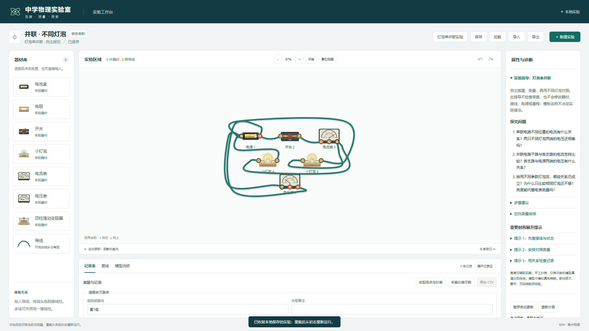

# M3 / 任务 08 实际验收

日期：2026-11-04。J-ELEC-01 灯泡串并联工程闭环通过；教材、课堂、实体设备和发布验收未进行，任务 09 未实施。

## 交付行为

顶部“灯泡串并联实验”提供正式空白入口及串联/并联、相同/不同灯泡四种模板。原“新建实验”仍保留自由搭建。先选择、预览明确配置，再确认替换；取消不改当前工作，每次新建独立文档。

模板使用电源、两灯、开关、导线、电流表和电压表，初态开关断开、接大量程；6/9/3 V 电源和两灯参数各自保存。可继续改线、移动、翻转、增删器材和参数。读数来自真实端口图，实验 ID/标题/布局不决定结果。

右侧可折叠指导包含问题、步骤、四行六测点空表和三层提示；空表只规划待测位置，实际数值仍通过既有记录表抄写或采集，观察与归纳随采样备注保存。提示没有文档修改回调，不替学生接线、选档、改电源或填读数。保存/重导入恢复实验身份和指导入口，旧数值、备注及接线/器材快照保持。

细节、独立手算与边界见[模型与流程](../models/lamp-circuit-experiment.md)、[决策 0011](../decisions/0011-m3-lamp-circuit-experiment.md)及[需求卡](../requirements/J-ELEC-01.md)。

## 实际检查

| 检查 | 结果与证据 |
| --- | --- |
| 全量单元/模型 | 210/210，0 失败/跳过/取消，约 1.89 秒；[原始输出](m3-task08-tests.txt) |
| 完整 Edge E2E | 47/47，0 失败/跳过/重试，86.2 秒；[输出](m3-task08-e2e.txt)、[JSON](m3-task08-e2e.json) |
| 类型与生产构建 | 三份 TS 配置及 build 退出码 0；[输出](m3-task08-build.txt)、[SHA256 清单](m3-task08-build-manifest.json) |
| lint | 最终演示文件加入后复核，退出码 0、无警告；[输出](m3-task08-lint.txt) |
| 独立模板演示 | 四个实际闭合模板的灯泡/电表/残差；[JSON](m3-task08-demo.json) |
| 开发启动 | 独立端口 5175 HTTP 200，检查后关闭本任务进程；[输出](m3-task08-dev.txt) |

原 203 项单元/模型和 43 项浏览器用例完整保留，新增 7/4 项，无删改旧用例。核心覆盖空白无器材/假数据、未知起点拒绝、四模板隔离/参数/开关/量程、相同与不同灯泡额定点、功率亮度和残差、开关/支路断开、反接、多量程误接/电流表跨源、名称/布局/顺序不影响结果、现有 JSON 格式往返、备注/手工记录/旧快照保持。原第 8.2 节线性与非线性/异常测试均继续通过。

## 空白闭环证据

串联和并联两个用例分别从正式空白开始，检查无器材/连接/记录，经原生器材卡片取用并点击画布放置 10 件器材，再逐个点端口建立真实导线；不通过导入预制场景开始，也不直接注入应用状态。

每条流程使用三个电流和三个电压测点，先测相同灯泡，再断开开关、更换一只灯泡参数并在需要时修改电源，闭合后记录第二组。实际采集值为：

| 接法与组合 | I总 / I₁ / I₂（A） | U总 / U₁ / U₂（V） |
| --- | --- | --- |
| 串联，相同 | 0.3 / 0.3 / 0.3 | 6 / 3 / 3 |
| 串联，不同 | 0.3 / 0.3 / 0.3 | 9 / 3 / 6 |
| 并联，相同 | 0.6 / 0.3 / 0.3 | 3 / 3 / 3 |
| 并联，不同 | 0.5 / 0.3 / 0.2 | 3 / 3 / 3 |

两条流程均验证第二组不覆盖第一组 6 条记录及其参数/接线快照，亮度随实际不同功率变化，图线使用六个电流记录点。完成 CSV 与 JSON 下载、本地保存、刷新恢复，再新建空白后重导入已下载 JSON，逐项核对器材/接线/12 条记录/快照及恢复读数；教材状态仍为 pending_teacher_review。

另一个用例覆盖四种模板创建、取消预览保留原工作、开关初态/闭合读数、只读指导展开前后 JSON 完全相同、修改源电压为零/撤销、保存刷新。390 px 软件触摸验证模板选择、闭合开关、指导/空表横向滚动及无页面横向溢出。

## 修复过程与截图

首轮核心 208/210：[输出](m3-task08-first-tests.txt)。新测试误用仪表属性名，改为检查实际电压支路；电流表跨源是零压约束冲突而非理想导线短路，按现有模型纠正诊断预期，求解器未修改。

首轮浏览器专项 3/4：[输出](m3-task08-first-e2e.txt)、[JSON](m3-task08-first-e2e.json)。并联两条线连续从同一端子引出时，选中线头优先于接线柱；用正常的选择器材操作清除线头选择后再接下一条线，保留全部断言。截图暴露窄屏按钮多行挤压及初始导线穿过器材，补充入口独占一行、窄屏初始缩放和可编辑曲线绕行，随后通过完整 47 项。

最终桌面模板、两类空白搭建/记录及窄屏截图均已目视核对：

[串联不同灯泡及旧记录保持](m3-task08-series.png)、[并联不同灯泡及旧记录保持](m3-task08-parallel.png)、[390 px 软件触摸指导与测点空表](m3-task08-touch.png)。截图中的记录为自动化验收数据，不冒充真实学生作业。

## 保持与限制

100 个起始源码/测试/脚本中 96 个哈希不变，仅 App、MeasurementPanel、DocumentPreview 和 CSS 为预期集成变更，新增工厂、两个 UI、两份测试和独立演示共 6 个文件。[基线](m3-task08-before.json)、[最终核对](m3-task08-integrity.json)保留。原物理小样、MNA/灯泡/仪表/Worker、器材实物、导线前景、历史、存储、schema/迁移与既有测试源码保持。无新增依赖，原注释、AGENTS.md、实施方案、唯一锁文件和声明核对。

开发 HTTP 初次在沙箱中因本机套接字权限被阻止；在允许访问的隔离检查中返回 200，服务检查后关闭。完整浏览器使用独立临时配置与测试预览服务，没有修改用户真实浏览器保存数据。

教材具体章节及审阅人/日期继续为空；空表是测点规划，不自动生成记录或评判答案。未采样草稿/提示展开状态不跨刷新保存，记录/备注/快照按既有机制保存；不模拟烧毁、热惯性、AC/RLC 或全局非理想模式。其他浏览器、实体触屏/笔、性能、离线及教师课堂验收仍待后续阶段。
