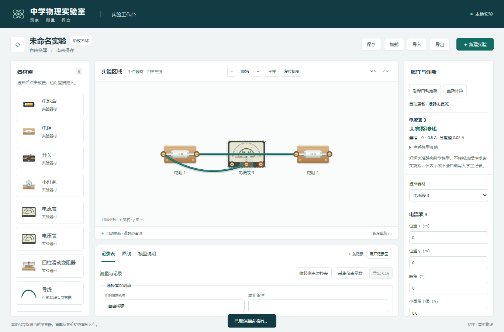

# 导线前景显示修订验收

日期：2026-11-04。用户要求导线放在器材前面，避免电表外壳遮住线段及接线去向。

## 行为与范围

SVG 先画器材，再画导线的阴影、线身及高光，接线柱图案覆盖在线端之上，弯曲点及自由/选中线头继续在前景。导线经过电表时可直接点击选中及拖动弯曲；接线柱、开关和滑片的操作区域从导线命中范围扣除。扣除区域以矩形并集分片，避免低缩放区域重叠后反而拦截接线柱；旋转/翻转后的控制区按世界坐标转换跟随。

仅修改 SceneBoard.tsx 的显示及命中处理，保留原有注释、端口事件和其他操作代码。新增两项实际 UI 测试；未改物理模型、接线图、历史、存储、格式或依赖。正式任务 08 未实施。

## 实际验证

- `npm run build`：三份 TS 配置与生产构建退出码 0；[输出](m3-wire-layer-build.txt)。最终测试文件调整后再次 `npm run typecheck` 退出码 0；[输出](m3-wire-layer-typecheck.txt)。
- `npm run lint`：退出码 0，无警告；[输出](m3-wire-layer-lint.txt)。
- 完整浏览器执行中，最终应用代码的原 41 项全部通过，新增两项因选中线头优先于接线柱而超时；[该轮输出](m3-wire-layer-second-e2e.txt)、[JSON](m3-wire-layer-second-e2e.json)。新测试按正常操作先选择器材，清除导线选择，再重复点击已接线柱；没有修改旧用例或放宽断言。
- 单独复验 `npm run test:e2e -- tests/e2e/wire-layer.spec.ts`：新增鼠标/软件触摸 2/2 通过，0 失败/跳过/重试；[输出](m3-wire-layer-focused.txt)、[JSON](m3-wire-layer-focused.json)。原 41 项与新增 2 项为分别验证，不声称同一轮 43/43 全量通过。
- 新用例以实际导线横跨电表为夹具，检查前景点击目标、弯曲的一次提交及撤销、端口中心连接和再次接线；最终截图已目视核对。
- 本次未重跑先前 203 项单元/模型；核心和物理源码未改。原注释完整性与构建清单见[核对结果](m3-wire-layer-integrity.json)，修改前 SceneBoard 原文见[基线](m3-wire-layer-before.json)。

首轮 39 通过、4 失败：[输出](m3-wire-layer-first-e2e.txt)、[JSON](m3-wire-layer-first-e2e.json)。发现线身前移后阻挡开关、圆形扣除区重叠恢复命中；已改为控制区避让及矩形并集。新夹具最初的默认垂弧恰好经过仪表端子，改为明确的表盘中部折点，确保测试实际复现器材遮线场景。

## 截图与限制

[软件触摸截图](m3-wire-layer-touch.png)。这是显示/操作夹具，未完整连接电流表，界面明确显示“未完整接线”；不冒充正常通电基准。软件触摸不等同实体触屏验收。

导线显示在前面不会改变实际电气关系，交叉仍不自动连接；控制区和已选择线头仍保留既有操作优先级。实体设备、其他浏览器和课堂验收范围保持原有待核验状态。
